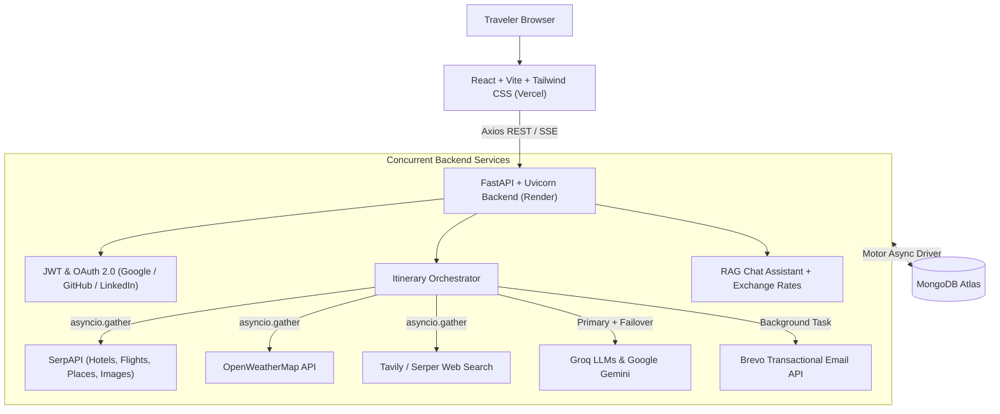

# TripNova — AI-Powered Travel Planner & Itinerary Generator

TripNova is a full-stack, AI-driven travel planning platform that turns trip preferences into realistic, budget-aligned, day-by-day itineraries in **Indian Rupees (₹ INR)**. Built with **React + Vite + Tailwind CSS** on the frontend and **Python FastAPI** on the backend, TripNova grounds Large Language Model generation (**Groq** with **Google Gemini** failover) in real-time hotel pricing, flight estimates, web search, and weather forecasts, paired with a context-aware AI travel assistant and automated HTML email delivery.

- **Live Frontend (Vercel):** [https://trip-nova-three.vercel.app](https://trip-nova-three.vercel.app)
- **Live Backend API (Render):** [https://tripnova-ys23.onrender.com](https://tripnova-ys23.onrender.com)

---

## Key Features

- **Personalized AI Itinerary Generation:** Creates structured day-by-day schedules (`Solo`, `Couple`, `Family`, `Group/Friends`) tailored to origin, destination, dates, budget (`₹ INR`), transport mode (`Flight`, `Train`, `Bus`), and personal preferences.
- **Multi-LLM Orchestration & Failover:** Uses **Groq** (dynamic active model discovery across `qwen/qwen3.8-27b`, `allam-2-7b`, `openai/gpt-oss-20b`) as the primary fast inference engine, automatically failing over to **Google Gemini** (`gemini-3.8-flash` via Interactions API / `generateContent`) with JSON extraction and compact recovery checks.
- **Real-Time Data Grounding (`asyncio.gather`):** Concurrently fetches live hotel rates & Google Flights in `INR` (**SerpAPI**), local recommendations (**Tavily** / **Serper**), and destination weather forecasts (**OpenWeatherMap**) to prevent AI price hallucinations.
- **Cost Predictor & Budget Analyzer (₹ INR):** Breaks down Accommodation, Food, Local Transport, Sightseeing & Activities, Round-Trip Travel, and Miscellaneous (10%), calculating Remaining Balance and budget sufficiency in Indian numbering format (`₹`).
- **Interactive AI Travel Copilot (RAG Chatbot):** Streaming SSE and REST chat assistant (`ChatAssistant`) backed by the generated itinerary context, live web search, and real-time currency conversion (`open.er-api.com`), persisted per trip in MongoDB Atlas.
- **Authentication & Security:** Supports Email + 6-digit OTP signup/password reset (SHA-256 hashed codes with 10-minute TTL), **Google / GitHub / LinkedIn OAuth 2.0**, `HS256` JWT sessions, bcrypt password hashing, and per-IP rate limiting (**SlowAPI**).
- **Automated Itinerary Email Dispatch:** Delivers branded **TripNova** HTML itinerary summaries and verification emails asynchronously over HTTPS using the **Brevo API v3** (with SMTP fallback for local dev).
- **Modern UX:** Responsive glassmorphism UI, `Light / Dark / System` theme persistence, Google Maps hotel links, cached hotel photo previews, profile photo compression (`Pillow`), and social travel video sharing.

---

## System Architecture



---

## Tech Stack

### Frontend (`frontend/`)
- **Framework & Build:** React `19.2`, Vite `8.0`
- **Styling & Animations:** Tailwind CSS `4.2`, Framer Motion `11.18`, Lucide React Icons
- **Routing & HTTP:** React Router DOM `6.30`, Axios `1.21`
- **Markdown Rendering:** `react-markdown`, `remark-gfm`

### Backend (`backend/`)
- **Framework & Server:** Python `3.12+`, FastAPI, Uvicorn (ASGI)
- **Validation & Config:** Pydantic, `pydantic-settings`, `python-dotenv`, `email-validator`
- **Async HTTP & Reliability:** `httpx`, `tenacity` (retry), `slowapi` (rate limiting)
- **Database:** MongoDB Atlas with `motor` (async driver) & `pymongo`
- **Security & Auth:** `PyJWT`, `passlib`, `bcrypt`, `authlib`
- **Media:** `Pillow` (avatar resizing & JPEG compression)

### External APIs & Hosting
- **AI / LLMs:** Groq API, Google Gemini API
- **Travel, Search & Weather:** SerpAPI, Tavily, Serper, OpenWeatherMap, ExchangeRate API (`open.er-api.com`)
- **Email:** Brevo API v3 (Production HTTPS) / SMTP (Local Dev)
- **Hosting:** Vercel (Frontend), Render (Backend)

---

## Project Structure

```text
TripNova/
├── backend/
│   ├── app/
│   │   ├── api/
│   │   │   ├── deps.py               # JWT auth dependency (get_current_user)
│   │   │   └── routes.py             # All REST & OAuth API routes
│   │   ├── core/
│   │   │   ├── config.py             # Pydantic environment settings
│   │   │   └── rate_limiter.py       # SlowAPI rate limiter
│   │   ├── db/
│   │   │   └── mongo.py              # Async Motor MongoDB client & indexes
│   │   ├── schemas/                  # Pydantic request/response models
│   │   │   ├── ai.py
│   │   │   ├── auth.py
│   │   │   ├── places.py
│   │   │   ├── profile.py
│   │   │   └── share.py
│   │   ├── services/
│   │   │   ├── auth_codes.py         # OTP generation, hashing & verification
│   │   │   ├── auth_service.py       # JWTAuth & OAuthService
│   │   │   ├── chat_service.py       # RAG assistant & SSE streaming
│   │   │   ├── currency_service.py   # Live forex fetching & caching
│   │   │   ├── email_service.py      # Brevo API & HTML email templates
│   │   │   ├── gemini_client.py      # Gemini Interactions & generateContent client
│   │   │   ├── groq_client.py        # Dynamic Groq model discovery & failover
│   │   │   ├── image_service.py      # Hotel image cache & Pillow compression
│   │   │   ├── itinerary_service.py  # Concurrent data fetch, LLM prompt & INR plans
│   │   │   ├── openweather_client.py # OpenWeatherMap forecast client
│   │   │   ├── serpapi_client.py     # Google Hotels, Flights, Places & search
│   │   │   ├── user_service.py       # User creation & bcrypt password checks
│   │   │   └── video_service.py      # Social video URL validation
│   │   └── main.py                   # FastAPI entry point, CORS & exception handlers
│   └── requirements.txt
├── frontend/
│   ├── src/
│   │   ├── components/
│   │   │   ├── auth/                 # AuthModal, ProfilePopover, AuthValidationHelpers
│   │   │   ├── ChatAssistant.jsx     # Streaming AI Travel Copilot drawer
│   │   │   ├── ChatWidget.jsx        # Modal chat widget
│   │   │   ├── Footer.jsx
│   │   │   └── Navbar.jsx
│   │   ├── lib/
│   │   │   └── apiClient.js          # Axios instance with Bearer token interceptor
│   │   ├── pages/
│   │   │   ├── HomePage.jsx          # Landing page & Share Your Trip
│   │   │   ├── PlanPage.jsx          # Trip form, INR Cost Predictor & Itinerary UI
│   │   │   ├── OAuthCallback.jsx     # OAuth token handler (/auth/success)
│   │   │   └── SignupPage.jsx
│   │   ├── state/
│   │   │   ├── auth/AuthProvider.jsx
│   │   │   ├── theme/ThemeProvider.jsx
│   │   │   └── trip/TripProvider.jsx
│   │   ├── ui/                       # AppShell & Modal portal
│   │   ├── App.jsx
│   │   └── main.jsx
│   └── package.json
└── README.md
```

---

## Core API Endpoints

| Method | Endpoint | Description |
| :--- | :--- | :--- |
| `GET` | `/api/health` | Service health check |
| `POST` | `/api/auth/send-code` | Send 6-digit OTP for signup or password reset |
| `POST` | `/api/auth/verify-code` | Verify OTP and create user / reset password |
| `POST` | `/api/auth/login` | Email & password login (returns JWT) |
| `GET` | `/api/auth/{provider}` | OAuth login (`google`, `github`, `linkedin`) + `/callback` |
| `GET` | `/api/places/autocomplete` | Place suggestions for origin and destination |
| `GET` | `/api/images/hotel` | Fetch & cache hotel photo URLs |
| `POST` | `/api/ai/generate-plan` | Generate INR itinerary, cost breakdown, hotels & send email |
| `POST` | `/api/ai/chat` | Ask a question to the RAG travel assistant |
| `POST` | `/api/ai/chat/stream` | Stream AI assistant reply via Server-Sent Events (SSE) |
| `GET` / `DELETE` | `/api/ai/chat/history` | Fetch or clear chat history for an itinerary |
| `GET` | `/api/user/trips/latest` | Recover latest saved trip for logged-in user |
| `GET` / `POST` | `/api/user/profile` | Get user profile or upload compressed profile photo |
| `POST` | `/api/share-video` | Submit a social travel video link |

---

## Local Development Setup

### Prerequisites
- **Node.js** (v18+ recommended) & `npm`
- **Python** (3.12+) & `pip`
- **MongoDB Atlas** URI

### 1. Clone the Repository

```bash
git clone https://github.com/kartikkes02/TripNova.git
cd TripNova
```

### 2. Backend Setup

```bash
cd backend
python -m venv venv

# Windows:
venv\Scripts\activate
# macOS/Linux:
# source venv/bin/activate

pip install -r requirements.txt
```

Create a `backend/.env` file:

```env
ENVIRONMENT=development
MONGODB_URI=your_mongodb_atlas_uri
MONGODB_DBNAME=tripnova

BASE_URL=http://localhost:8000
FRONTEND_URLS=http://localhost:5173
JWT_SECRET_KEY=replace_with_a_long_random_secret

# AI Providers
GROQ_API_KEY=your_groq_api_key
GEMINI_API_KEY=your_gemini_api_key

# Travel, Search & Weather APIs
SERPAPI_KEY=your_serpapi_key
TAVILY_API_KEY=your_tavily_api_key
SERPER_API_KEY=your_serper_api_key
OPENWEATHER_API_KEY=your_openweather_api_key

# OAuth (Optional for social login)
GOOGLE_CLIENT_ID=your_google_client_id
GOOGLE_CLIENT_SECRET=your_google_client_secret
GITHUB_CLIENT_ID=your_github_client_id
GITHUB_CLIENT_SECRET=your_github_client_secret
LINKEDIN_CLIENT_ID=your_linkedin_client_id
LINKEDIN_CLIENT_SECRET=your_linkedin_client_secret

# Email (Brevo API recommended; SMTP works locally)
BREVO_API_KEY=your_brevo_v3_api_key
SENDER_EMAIL=your_verified_sender@gmail.com
EMAIL_FROM=your_verified_sender@gmail.com
SENDER_NAME=TripNova
NOTIFY_EMAIL=your_admin_email@gmail.com

SMTP_HOST=smtp.gmail.com
SMTP_PORT=587
SMTP_USER=your_email@gmail.com
SMTP_PASSWORD=your_gmail_app_password
```

Run the backend server:

```bash
uvicorn app.main:app --reload --port 8000
```

### 3. Frontend Setup

Open a second terminal:

```bash
cd frontend
npm install
```

Create a `frontend/.env` file:

```env
VITE_API_BASE_URL=http://localhost:8000
```

Run the frontend dev server:

```bash
npm run dev
```

Open `http://localhost:5173` in your browser.

---

## Production Deployment

### Backend on Render
- **Root Directory:** `backend`
- **Build Command:** `pip install -r requirements.txt`
- **Start Command:** `uvicorn app.main:app --host 0.0.0.0 --port $PORT`
- **Required Environment Variables:** Set all keys from `backend/.env` above, plus:
  - `ENVIRONMENT=production`
  - `BASE_URL=https://your-backend.onrender.com`
  - `FRONTEND_URLS=https://your-frontend.vercel.app`
  - `BREVO_API_KEY`, `SENDER_EMAIL`, `EMAIL_FROM`, `SENDER_NAME=TripNova` *(Use Brevo HTTPS API in production since cloud free tiers block outbound SMTP ports `587`/`25`.)*
- **OAuth Redirect URIs:** Add `https://your-backend.onrender.com/api/auth/google/callback` (and GitHub/LinkedIn equivalents) in each provider's developer console.

### Frontend on Vercel
- **Root Directory:** `frontend`
- **Build Command:** `npm run build`
- **Output Directory:** `dist`
- **Environment Variable:**
  - `VITE_API_BASE_URL=https://your-backend.onrender.com`

---

## Author

**Kartikeya Kesarwani**
